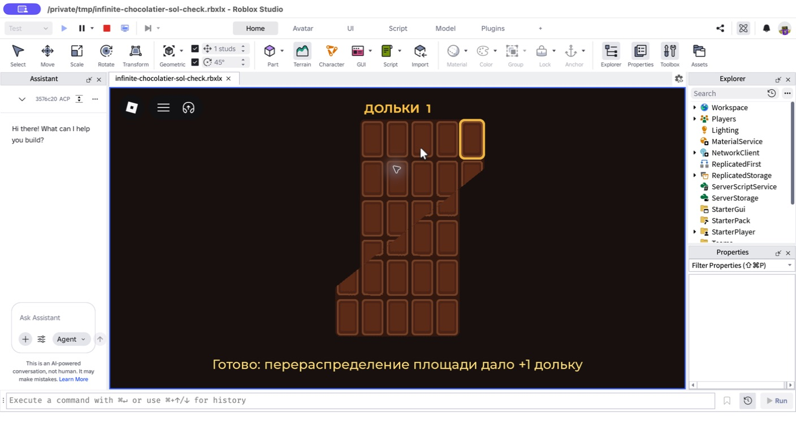

# Infinite Chocolatier

Новая реализация идеи **infinite chocolate trick**: сначала игрок вручную
разрезает плитку жестом мыши, затем сдвигает кусок, получает дольку и повторяет
цикл. Позже дольки будут покупать новые плитки, автоматические резаки,
передвигатели и умпа-лумпов.

## Первый срез

- одна плитка и один рецепт;
- один непрерывный диагональный рез по пунктирной линии;
- перемещение настоящей верхней полигональной области в целевое место;
- высокие прямоугольные дольки вместо квадратной сетки: так небольшое
  перераспределение ширины не бросается в глаза;
- серверный счётчик долек;
- первый экран собран вокруг крупной плитки и нижней инструкции, без
  стандартного Roblox HUD;
- локальный запуск через Rojo/Roblox Studio, без публикации place.

Ключевая часть иллюзии — не удаление и не создание клетки. Исходные рельефные
примитивы плитки математически разделяются одной диагональю на две
полуплоскости. Пересечённые примитивы растрируются только вдоль границы с
точностью в один пиксель, поэтому рамки и рисунок не выходят за полигон.
Верхняя область переносится целиком строго вдоль шва; дополнительной становится
реальная исходная долька, вышедшая за прежний контур.



## Проверки

```bash
rokit install
lune run tests/run
rojo build --output /tmp/infinite-chocolatier-sol-check.rbxlx
```

Для живой проверки нужен один экземпляр Roblox Studio:

```bash
rojo serve
```

Затем в Studio подключить Rojo и нажать Play.

Финальная локальная проверка 2026-08-19: 23 теста прошли, сборка Rojo успешна,
полный игровой цикл завершился без сообщений в Output. Place не публиковался.
