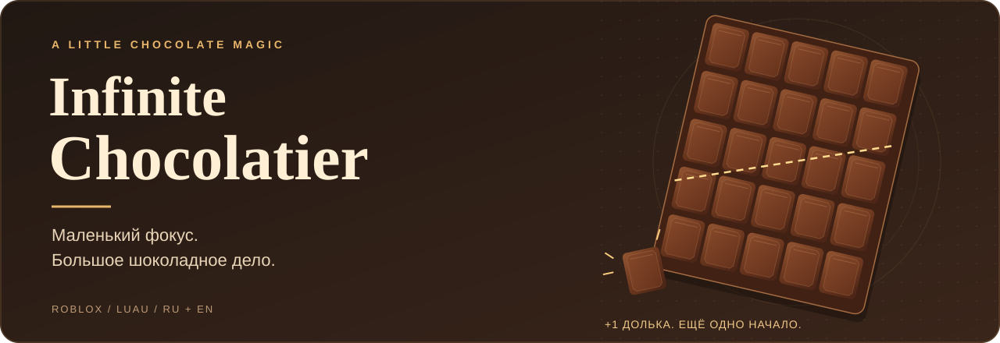
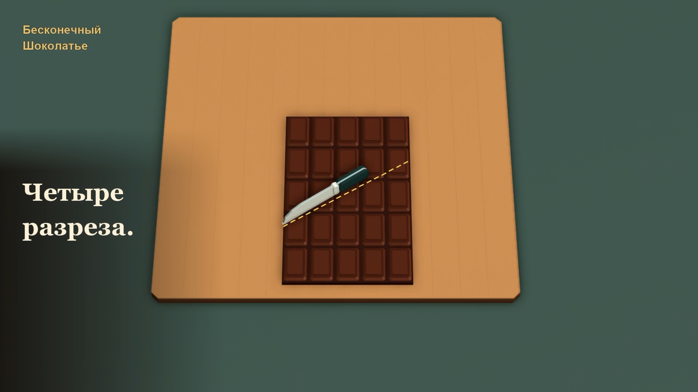
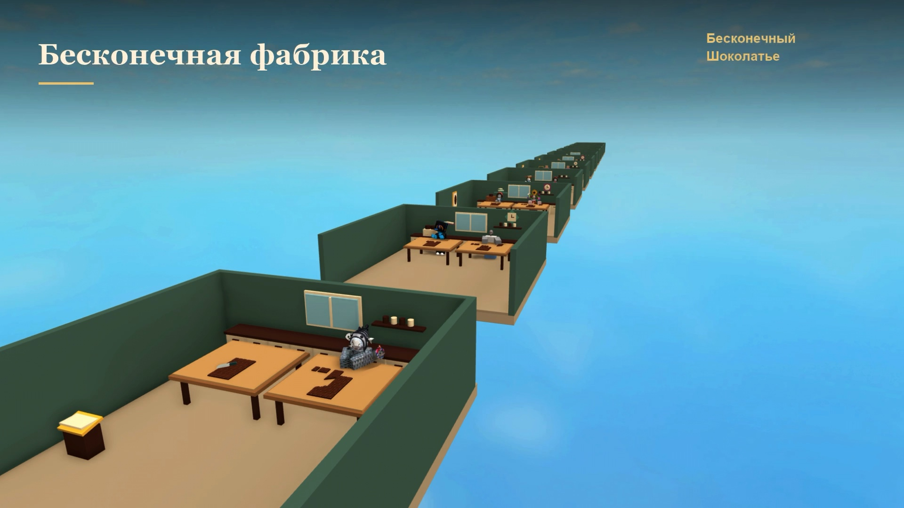

<p align="center">
  
</p>

<p align="center">
  <strong>Четыре разреза. Две перестановки. Ещё одна долька.</strong><br>
  Уютная игра в Roblox, в которой шоколадный фокус превращается в собственное кафе.
</p>

<p align="center">
  <a href="https://www.roblox.com/games/82798785130025/"><strong>▶ Играть в Roblox</strong></a>
  &nbsp; · &nbsp;
  <a href="docs/GAMEPLAY.md">Как играть</a>
  &nbsp; · &nbsp;
  <a href="docs/DEVELOPMENT.md">Разработка</a>
  &nbsp; · &nbsp;
  <a href="https://github.com/ch3pasov/infinite-chocolatier/issues/new/choose">Сообщить об ошибке</a>
</p>

---

## От одной плитки до своего кафе

В основе **Infinite Chocolatier** — оптический фокус с бесконечной шоколадкой.
Разрежь плитку по подсказкам, переставь части и забери оставшуюся дольку.
Потом вложи заработанное в мастерство, помощников и оформление кухни.

| Сделай фокус | Построй своё дело |
| :--- | :--- |
| **Режь и собирай.** Веди нож мышью или пальцем; подсказки помогут закончить первую плитку. | **Развивай кафе.** Нанимай стажёров, улучшай рецептуру и открывай новые кафе. |
| **Осваивай мастерство.** Улучшения увеличивают награду и ускоряют работу. | **Обживай кухню.** Примеряй мебель, выбирай декор и гуляй по своему кафе. |
| **Возвращайся за прогрессом.** Помощники приносят доход, в том числе за время отсутствия — до четырёх часов. | **Заглядывай к соседям.** Посещай кафе игроков своего сервера и следи за общим топом. |

## Загляни в шоколадное ателье

<p align="center">
  
</p>

<p align="center">
  
  <br><sub>Кадры из игрового трейлера v9. Интерфейс развивается вместе с игрой.</sub>
</p>

## Начни с маленького фокуса

1. Пройди четыре разреза и две перестановки по подсказкам.
2. Купи первое улучшение мастерства и накопи на открытие кухни.
3. Найми стажёра, обустрой кафе и открой новое ателье ради звёздного бонуса.

Игра поддерживает **русский и английский языки**, мышь и сенсорный ввод.
Кнопка **♪** открывает музыку и отдельную настройку громкости эффектов.
Подробности — в [руководстве игрока](docs/GAMEPLAY.md).

## Запустить из исходников

Нужны **Roblox Studio**, **Foreman** и **Python 3.9+**.
Версии Lune и Rojo закреплены в [foreman.toml](foreman.toml).

```sh
foreman install
python3 tools/check.py
rojo build --output /tmp/infinite-chocolatier.rbxlx
```

Открой полученный файл в одном окне Roblox Studio и запусти Play.
**В Studio прогресс хранится только в памяти:** локальная проверка не затрагивает
профили игроков. Устройство проекта и работа с локализацией описаны
в [руководстве разработчика](docs/DEVELOPMENT.md).

## Карта проекта

| Куда заглянуть | Что внутри |
| :--- | :--- |
| [Руководство игрока](docs/GAMEPLAY.md) | Первые покупки, прогулка, кафе и сохранения |
| [Разработка](docs/DEVELOPMENT.md) · [Внесение изменений](CONTRIBUTING.md) | Устройство кода, инструменты и проверки |
| [Звук](AUDIO.md) · [Локализация](localization/README.md) | Музыка, эффекты и тексты RU/EN |
| [Геометрия фокуса](REFERENCE_ANALYSIS.md) | Почему появляется лишняя долька |
| [Состав выпуска](RELEASE.md) · [Бэклог](BACKLOG.md) | Выпущенные возможности и оставшаяся приёмка |
| [Передача проекта](HANDOFF.md) | Решения, ограничения и история проверок |

<p align="center"><sub>Roblox · Luau · Rojo · Lune · Сделано для маленьких шоколадных открытий</sub></p>
